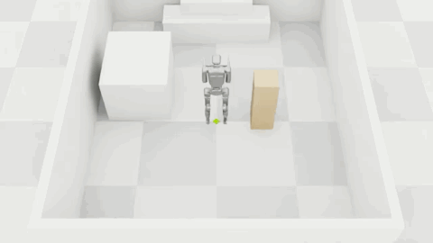
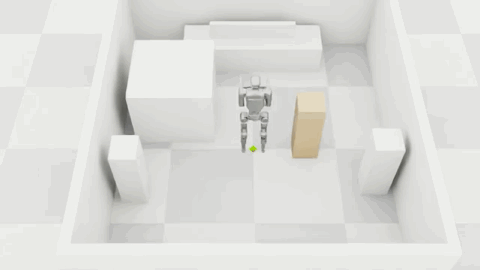

# Furniture-Moving Rehearsal

[](LICENSE)

**A simulated humanoid tries the furniture move first.**

For people who cannot move furniture themselves, this project explores three questions: **Can it be moved? How can it be moved? Can the result be explained simply?** A room photo and reference dimension become an editable 3D scene. The user selects furniture and a destination by clicking or speaking, confirms the preview, and a Unitree G1 rehearses the move in Isaac Sim. Muse Spark explains the result in plain English or Korean.

Built for **Push the Frontier** at the Meta Global AI Developer Hackathon. This is a **VLM-guided humanoid controller**: all robot motion is simulated, with no physical robot involved.

## Watch the rehearsals

Both previews loop automatically at **2× speed**.

**Lift and carry · 21 s** — approach, grasp, lift, carry and set down.



**Two moves in one room · 46 s** — two completed moves, joined in order; final placement errors of **1.1 and 1.4 cm**.



These are Isaac Sim recordings. The second clip includes the two completed moves only; a third item by the wall remained unmoved. [Recording provenance](assets/videos/manifest.json).

## Meta AI in Furniture-Moving Rehearsal

| Meta model or package | What it does here |
| --- | --- |
| **SAM 3.1** (`sam-3.1`) | Segments furniture and the reference door from the room photo, one short noun phrase per request. Its boxes and masks feed scene construction and the viewer's photo overlay. |
| **Muse Spark 1.3** (`muse-spark-1.3`) | Interprets the photo and SAM detections to estimate the room layout, furniture dimensions and mass. Maps spoken requests to furniture IDs and destinations, proposes move strategies, and diagnoses the bookcase's failed lift from measured results and representative frames. Provides plain-language English/Korean explanations. |
| **Muse Voice Transcribe** (`muse-voice-transcribe-1.0`) | Converts the user's recorded move request into text, with Korean and English language hints. The transcript and Spark's interpretation are shown before the user confirms the move. |
| **Muse Image** (`muse-image-1.0`) | Generated the demo room images and edited the pedestal room to add two matching items. Used to prepare demo assets, not on each move request. |
| **meta-sam-parser** | Decodes SAM's mask payloads for the photo overlay and furniture colour extraction; this is a supporting package, not a model. |

Model calls share the cached [Meta client](scripts/meta_models.py); the [scene config](configs/scene_from_image.json) and [advisor config](configs/rehearsal_advisor.json) pin the Spark model. Meta supplies scene interpretation, intent and strategy; Isaac Sim and the controller execute the motion and measure the outcome. Recorded playback reuses saved results without calling the models.

## What the demo shows

| Demo | Recorded result |
| --- | --- |
| Light pedestal | Approach, grasp, lift, carry and set down |
| Heavy bookcase | Failed lift → Muse Spark diagnosis → push on furniture sliders |
| Two moves in one room | Placement errors of 1.1 and 1.4 cm; a third item by the wall remained unmoved after wall contact |

The WebGL viewer replays recorded robot link poses and furniture motion. Its **How Meta built this room** view overlays SAM masks and estimated dimensions on the source photo. **Try it** lets users correct furniture, preview destinations, queue moves and request a new rehearsal.

The placement numbers describe the included recordings, not a general success guarantee. Grasping uses rigid hand–object attachments; the carry demo uses corrected dimensions and mass, and the push demo assumes furniture sliders. The submitted scene flow covers room rearrangement; it does not demonstrate arbitrary homes or hallway/corner passage.

## Bundled policies and measured performance

The three project-trained checkpoints are included in [models/](models/) (**1.55 MB total**). The default rehearsal config loads them directly; users do not need to retrain. Approach and carry are residual PPO policies over scripted navigation; push is a high-level PPO controller. All three command the frozen GR00T whole-body controller.

| Policy / checkpoint | Learned success | Scripted baseline | Median successful episode time, learned / scripted |
| --- | --- | --- | --- |
| [Approach](models/approach.pt) — reach the pre-grasp pose | **86.3%** (221/256) | 83.2% (213/256) | 14.5 / 17.3 s |
| [Carry](models/carry.pt) — carry a 2–4 kg item to the goal pose | **78.9%** (202/256) | 42.6% (109/256) | 18.65 / 16.4 s |
| [Push](models/push.pt) — push a 5–20 kg box 1 m on sliders | **87.9%** (225/256) | 27.3% (70/256) | 6.5 / 11.65 s |

These are **per-skill evaluations from one training run each**, using 256 matched starts (evaluation seed 1) on each run's sampled training environments (seed 0). They are not held-out-room generalization or end-to-end rehearsal success rates. Times are simulated seconds among each controller's successful episodes, not wall-clock latency or paired speed comparisons.

- **Approach:** reach within 6 cm / 8° and stop at ≤0.05 m/s within 30 s, without triggering a failure condition.
- **Carry:** reach within 10 cm / 10° and stop at ≤0.05 m/s within 40 s, with a 2–4 kg attached item and no failure condition. This measures the carry stage, before the rehearsal's final alignment and set-down.
- **Push:** achieve 1 m box displacement within 20 s without triggering a failure condition; mass 5–20 kg, slider friction 0.05–0.15.

[Evaluation evidence](models/evaluation.json) retains episode outcomes/times and success criteria. The [model manifest](models/manifest.json) records SHA-256 hashes, source training runs, matching configs and runtime versions. Original checkpoint contents, including observation normalizers, are preserved. Verify the bundle offline with `uv run --locked python -m unittest discover -s tests -p 'test_bundled_policies.py' -v`.

## How it works

1. **Photo → room:** SAM 3.1 segments furniture; Muse Spark estimates dimensions and mass using the photo and a dimension reference. Users correct these estimates.
2. **Request → destination:** click an item and a spot, or use Muse Voice Transcribe and Muse Spark to interpret a spoken request. Confirm the selected item and green preview.
3. **Plan → rehearsal:** geometry checks and Muse Spark select a move strategy. Isaac Sim executes the approach, lift/carry or push, and placement using GR00T whole-body control and PPO-trained policies.
4. **Outcome → explanation:** measured states drive the replay and placement results; Muse Spark diagnoses the bookcase lift failure and explains the strategy change.

All Meta calls use one [client](scripts/meta_models.py) with response caching. Included room images were generated with Muse Image; they are not photographs of real homes. New photo-to-scene conversion is available through [scene_from_image.py](scripts/scene_from_image.py); the browser currently uses prepared scenes.

## Run the recorded demos

Requires Python 3.12 and `uv`. Run these commands from the repository root:

```sh
uv sync --locked --no-build
uv run --locked python scripts/fetch_g1_meshes.py
python3 -m http.server 8000 --bind 127.0.0.1
```

Open **http://127.0.0.1:8000/web/**. The mesh fetcher downloads and verifies about 31 MB of G1 visual assets on first use. The three recorded demos need neither an API key nor a GPU. The static server does not run new rehearsals.

## Try a new move

### Local interface

Set `META_API_KEY` in your environment or a Git-ignored `.env` file using [.env.example](.env.example) as the template. Stop the static server, then run:

```sh
uv run --locked python scripts/rehearsal_server.py --port 8000
```

Open **http://127.0.0.1:8000/web/** and select a **Try it** room:

1. Click furniture, or press **Speak a move**, speak, and press **Stop and send**.
2. Check the transcript, selected item, dimensions and mass. **Use carry size** applies a demo preset of **0.28 × 0.30 × 0.90 m, 3 kg**; it does not measure the photographed item.
3. Confirm or adjust the green destination preview, then press **Check with Meta and add**. Repeat to queue another move.
4. Press **Rehearse all**. Once the remote run finishes, inspect its replay, outcome and placement error.

Voice input and Meta checks use the API. New rehearsals additionally require the running Isaac session and policy files described below. The local server uses the latest generated SSH configuration under `outputs/modal/`. Startup can take several minutes; each queued move starts a separate Isaac process.

### Isaac worker

The [Isaac profile](configs/modal_isaac.json) requests **one Modal L40S, 4 CPU cores and 32 GiB RAM**, with a **3-hour session limit**. The pinned runtime uses Isaac Lab v3.0.0, Isaac Sim 6.2.0.0, PyTorch 2.11.0/CUDA 13.0 and RSL-RL 5.5.1. The root Python environment, Modal orchestrator and remote runtime are separate.

With Modal authentication and an SSH key configured, inspect the resource/cost plan first. Starting the session incurs compute charges; the EULA flag records acceptance of NVIDIA's terms.

```sh
python3 scripts/modal_dev.py plan --config configs/modal_isaac.json
uv sync --project environments/modal --locked --no-build
uv run --project environments/modal --locked python scripts/modal_dev.py start --config configs/modal_isaac.json --accept-isaac-eula
```

Use the SSH command printed by the launcher. On the worker, place this checkout at `/workspace/repo/Furniture-Moving-Rehearsal`, then run from that project root:

```sh
/opt/isaaclab/.venv/bin/python scripts/isaac_preflight.py --stage all
```

Preflight checks runtime versions, CUDA, headless Vulkan/RTX and a bounded G1 physics/camera smoke test. A smoke-test pass establishes runtime readiness, not furniture-moving success. The plain launcher without `--config configs/modal_isaac.json` starts an SSH-only environment and cannot run the rehearsal.

The [rehearsal config](configs/isaac_g1_rehearsal.json) loads the bundled `models/approach.pt`, `models/carry.pt` and `models/push.pt`. Keep the matching training configs: the loader uses them to reconstruct the networks. GR00T Balance/Walk weights are separately downloaded and hash-verified by the runners. For optional retraining, use [room training](scripts/isaac_g1_room.py) and [push training](scripts/isaac_g1_ppo.py); locally generated checkpoints under `outputs/isaac/` remain supported.

Run artifacts stay under the checkout's `outputs/isaac/<run-id>/`. In the remote shell, **`fmr-save`** syncs the workspace and **`fmr-stop`** saves and releases the session. Saving is not a policy-checkpoint command. Closing the browser or SSH viewer does not stop GPU billing.

## Development

Run offline tests and inspect a move without an API call or GPU:

```sh
uv run --locked python -m unittest discover -s tests -v
uv run --locked python scripts/isaac_g1_rehearsal.py --dry-run
```

Hardware/SDK-dependent checks may skip in the local environment. GPU execution and recorded motion require separate validation.

| Location | Purpose |
| --- | --- |
| [web/](web/) | Interactive viewer, recorded demos and vendored browser dependencies |
| [scripts/rehearsal_server.py](scripts/rehearsal_server.py) | Local API, move queue and remote job orchestration |
| [scripts/isaac_g1_rehearsal.py](scripts/isaac_g1_rehearsal.py), [sequence runner](scripts/rehearsal_sequence.py) | Single and sequential physics rehearsals |
| [scripts/meta_models.py](scripts/meta_models.py), [advisor](scripts/rehearsal_advisor.py), [scene conversion](scripts/scene_from_image.py), [room uploads](scripts/room_upload.py) | Meta calls, strategy/diagnosis, browser upload and photo-to-scene conversion |
| [configs/](configs/) | Runtime, controller, training, scene and request settings |
| [models/](models/) | Three bundled project-trained policies, hashes and evaluation evidence |
| [tests/](tests/), [test fixtures](tests/fixtures/), [assets/references/](assets/references/) | Offline checks, historical regression profiles and pinned robot/reference data |
| [environments/modal/](environments/modal/) | Isolated Modal launcher environment and lockfile |

## Original contributions and third-party components

| Built during the hackathon | Imported components |
| --- | --- |
| [Meta client](scripts/meta_models.py), [scene conversion](scripts/scene_from_image.py), [browser upload pipeline](scripts/room_upload.py), [advisor](scripts/rehearsal_advisor.py), [image prompts](configs/home_images.json) | Meta Model API: SAM 3.1, Muse Spark, Muse Voice Transcribe, Muse Image; meta-sam-parser |
| [GR00T-to-Isaac adapter](scripts/g1_wbc.py), [controller runner](scripts/isaac_g1_wbc.py), contact/dynamics checks | GR00T-WBC Balance/Walk weights, G1 URDF and derived deployment/contact reference data |
| [Parallel environments](scripts/isaac_g1_rl.py), [push PPO](scripts/isaac_g1_ppo.py), [lift](scripts/isaac_g1_lift.py), [corridor carry](scripts/isaac_g1_carry.py), [room policies](scripts/isaac_g1_room.py), evaluation scripts and [geometry](scripts/room_geometry.py) | Isaac Sim, Isaac Lab, RSL-RL, PyTorch, G1 USD assets |
| Bundled [approach](models/approach.pt), [carry](models/carry.pt) and [push](models/push.pt) checkpoints, trained during the hackathon; [evaluation evidence](models/evaluation.json) | Frozen GR00T-WBC low-level policies and the training stack; GR00T weights are downloaded separately |
| [Rehearsal](scripts/isaac_g1_rehearsal.py), [sequences](scripts/rehearsal_sequence.py), [server](scripts/rehearsal_server.py), [WebGL UI](web/), [replay export](scripts/export_replay.py), [mesh fetcher](scripts/fetch_g1_meshes.py), recorded demos and [looping previews](assets/videos/) | three.js and G1 visual meshes; Isaac Sim rendering |
| [Modal launcher](scripts/modal_dev.py), [preflight](scripts/isaac_preflight.py), [asset inventory](scripts/isaac_g1_asset.py), [recording](scripts/isaac_video.py), [observer](scripts/isaac_observe.py), tests and documentation | Modal SDK, NumPy, FFmpeg/libx264, Ubuntu/libXt, OpenSSH, Git and uv |

## License and third-party terms

The original project source code, documentation and three project-trained policy checkpoints are open source under the [MIT License](LICENSE). Imported code, robot assets, upstream model weights and Meta services retain their own licenses and terms below; the MIT license does not replace them. GR00T weights are downloaded separately and are not included in the three project-trained checkpoints.

| Component | Source and terms |
| --- | --- |
| Meta models and generated room images | [Meta Model API](https://dev.meta.ai/docs/models), under Meta's terms. Demo images were generated/edited with Muse Image's image/web search disabled; no real homes or people. |
| SAM mask decoder | [meta-sam-parser](https://github.com/meta-models/meta-sam) 0.1.0, SAM License; pinned in `uv.lock`. |
| GR00T-WBC | [Pinned upstream source](https://github.com/NVlabs/GR00T-WholeBodyControl/tree/4141c34280abb67c82e115342a8720f4a83d750d): source under Apache-2.0, weights under NVIDIA Open Model License. [Retained notices](licenses/GR00T-WBC.txt). **Licensed by NVIDIA Corporation under the NVIDIA Open Model License.** |
| G1 URDF and visual meshes | [Reference URDF](assets/references/g1_wbc.urdf) retained unmodified; meshes downloaded using the [pinned manifest](web/vendor/g1/meshes.json). [Unitree BSD-3-Clause notice](licenses/UNITREE-BSD-3-CLAUSE.txt) and upstream notices retained. |
| three.js | r186 / npm 0.186.1, MIT. [License](web/vendor/three/LICENSE) and [file hashes](web/vendor/three/vendor.json) accompany the vendored code. |
| Isaac Sim and G1 USD | [NVIDIA terms](https://docs.isaacsim.omniverse.nvidia.com/latest/common/legal.html), [Omniverse EULA](https://docs.isaacsim.omniverse.nvidia.com/latest/common/NVIDIA_Omniverse_License_Agreement.html) and [additional asset terms](https://docs.isaacsim.omniverse.nvidia.com/latest/common/license-isaac-sim-additional.html). USD assets are fetched at runtime, not bundled here. |
| Training stack | [Isaac Lab](https://github.com/isaac-sim/IsaacLab/tree/v3.0.0) and [RSL-RL](https://pypi.org/project/rsl-rl-lib/5.5.1/) use BSD-3-Clause; [PyTorch](https://github.com/pytorch/pytorch/blob/main/LICENSE)/Torchvision use BSD-style notices; Warp uses Apache-2.0 and bundled notices. |
| Local tools and infrastructure | NumPy and its bundled notices; [Modal SDK](https://github.com/modal-labs/modal-client) Apache-2.0; [uv](https://github.com/astral-sh/uv) MIT/Apache-2.0; OpenSSH component licenses; Git GPL-2.0; Ubuntu package notices and libXt MIT/X11-style notices. |
| Video encoding | [FFmpeg](https://github.com/FFmpeg/FFmpeg/blob/n6.1.1/LICENSE.md) with libx264 is invoked as a separate process; the selected build includes GPL terms. Retain distribution copyright and linked-library notices. |
| README previews | Rendered from this project's Isaac Sim rehearsals during the hackathon, using the G1 assets credited above. Looping GIFs sample the recordings at 480 × 270 and 10 fps, with 2× playback speed. [Source runs and hashes](assets/videos/manifest.json). |

Dependency versions and hashes live in the root and Modal `uv.lock` files and the pinned Isaac runtime configuration. Retain installed distributions' license files when redistributing binaries. Keys belong in environment variables or the ignored `.env`. Only the three selected project-trained checkpoints and their manifest/evaluation records are included; downloaded upstream weights, other training checkpoints, API caches and experiment outputs stay out of Git.

## Documentation

See [AGENTS.md](AGENTS.md) for collaboration and development guidelines.
